# Mi oficina · Autónomos de España

**Clientes, citas y contabilidad conectados**, con entradas previstas desde Gmail, ChatGPT y WhatsApp. Plantilla pública para crear una oficina privada por autónomo.

## Probar el panel

<picture>
  <source media="(prefers-color-scheme: dark)" srcset="docs/images/admin-dark.svg">
  <source media="(prefers-color-scheme: light)" srcset="docs/images/admin-light.svg">
  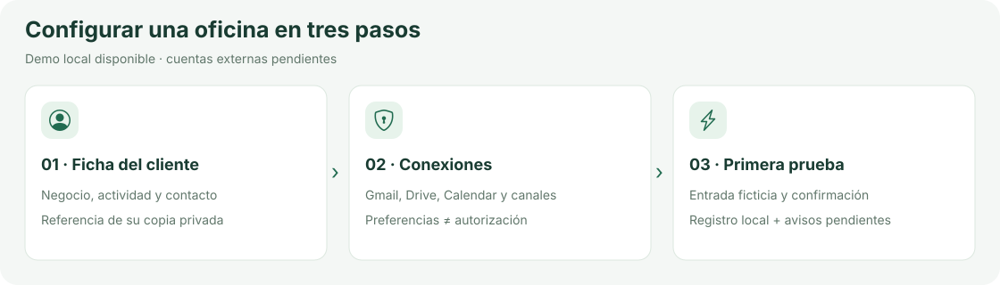
</picture>

Python 3.12+, sin instalar dependencias:

```bash
python3 -m app.server
```

Abre el puerto local **8000**: `/` muestra el admin y `/gestion` los registros. Datos locales en SQLite, fuera de Git. `PORT` y `AGENDA_DB` permiten cambiar puerto y ruta; `.env` no se carga automáticamente.

**Admin:** ficha → conexiones → prueba → avisos. [Crear copia privada](docs/INICIO_PRIVADO.md).

## Así se verá tu oficina

Ejemplos visuales con datos ficticios. **Diseño previsto:** las conexiones, OCR y sincronización todavía no están implementados.

### De la entrada a la acción

<picture>
  <source media="(prefers-color-scheme: dark)" srcset="docs/images/entradas-dark.svg">
  <source media="(prefers-color-scheme: light)" srcset="docs/images/entradas-light.svg">
  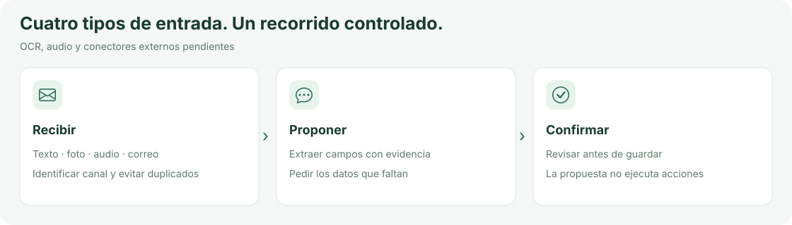
</picture>

### Tu Drive, organizado y relacionado

<picture>
  <source media="(prefers-color-scheme: dark)" srcset="docs/images/drive-dark.svg">
  <source media="(prefers-color-scheme: light)" srcset="docs/images/drive-light.svg">
  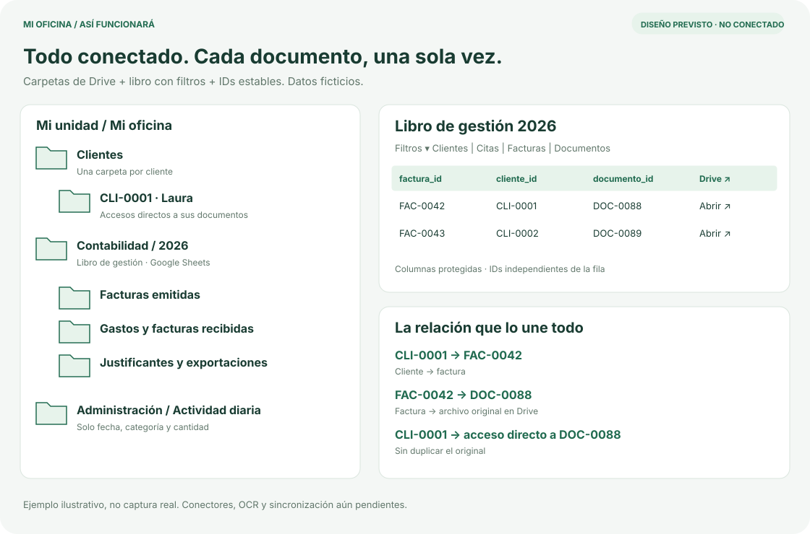
</picture>

Cada archivo se guarda una vez; clientes, facturas y documentos se enlazan por ID.

### De ChatGPT a un gasto organizado

<picture>
  <source media="(prefers-color-scheme: dark)" srcset="docs/images/chatgpt-dark.svg">
  <source media="(prefers-color-scheme: light)" srcset="docs/images/chatgpt-light.svg">
  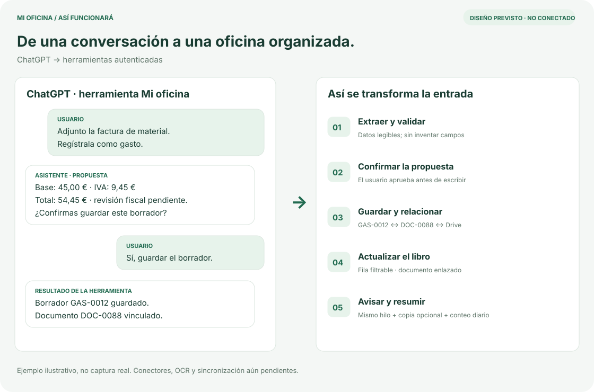
</picture>

Adjuntar → extraer → confirmar → guardar borrador → avisar.

### De una foto en WhatsApp a un registro

<picture>
  <source media="(prefers-color-scheme: dark)" srcset="docs/images/whatsapp-dark.svg">
  <source media="(prefers-color-scheme: light)" srcset="docs/images/whatsapp-light.svg">
  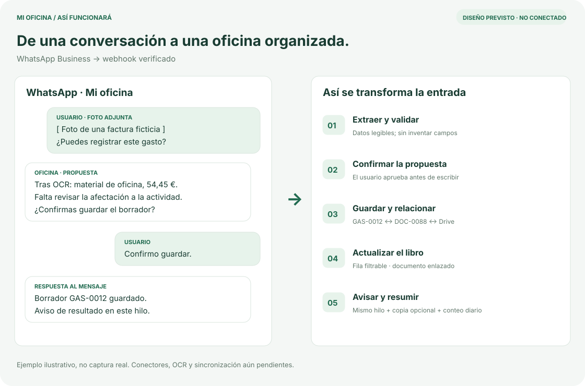
</picture>

Foto → OCR → revisión → documento en Drive + registro enlazado.

### La cita conecta agenda y contabilidad

<picture>
  <source media="(prefers-color-scheme: dark)" srcset="docs/images/calendar-dark.svg">
  <source media="(prefers-color-scheme: light)" srcset="docs/images/calendar-light.svg">
  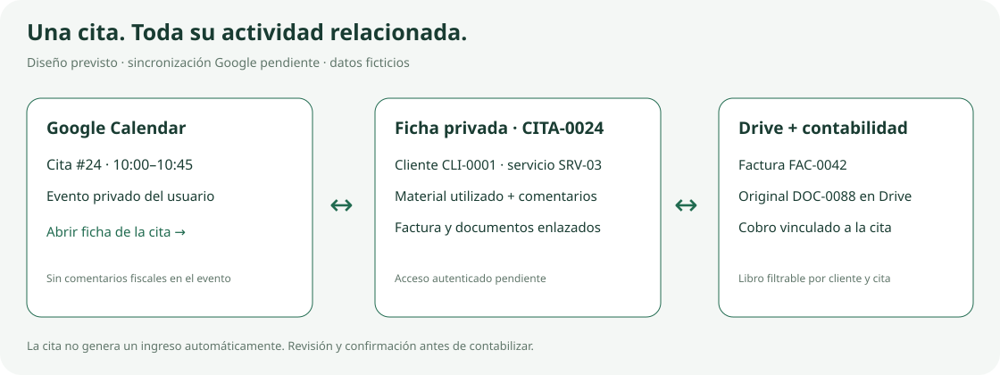
</picture>

**Destino previsto: el Google Calendar del usuario.** Cada cita enlazará su ficha privada y los documentos de Drive; los IDs la relacionarán con la contabilidad. [Contrato de agenda y sincronización](docs/AGENDA.md).

### Avisos y actividad diaria

<picture>
  <source media="(prefers-color-scheme: dark)" srcset="docs/images/avisos-dark.svg">
  <source media="(prefers-color-scheme: light)" srcset="docs/images/avisos-light.svg">
  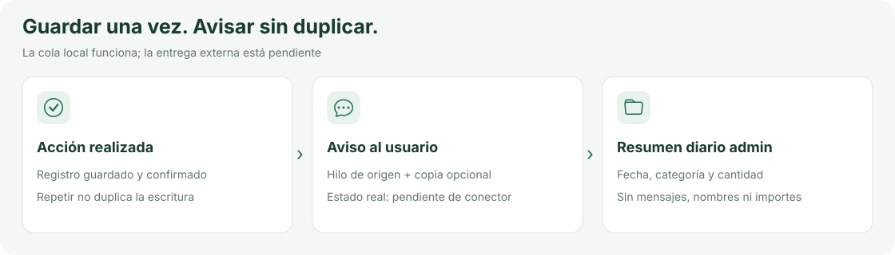
</picture>

### Privacidad por diseño

<picture>
  <source media="(prefers-color-scheme: dark)" srcset="docs/images/privacidad-dark.svg">
  <source media="(prefers-color-scheme: light)" srcset="docs/images/privacidad-light.svg">
  
</picture>

## Qué funciona y qué falta

<picture>
  <source media="(prefers-color-scheme: dark)" srcset="docs/images/estado-dark.svg">
  <source media="(prefers-color-scheme: light)" srcset="docs/images/estado-light.svg">
  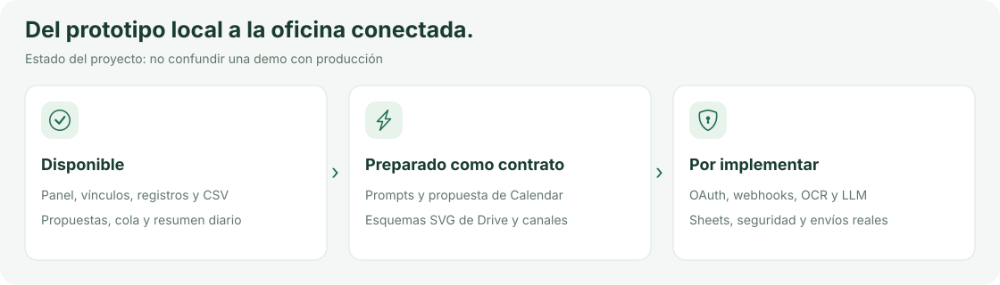
</picture>

| Parte | Disponible ahora | Pendiente |
| --- | --- | --- |
| Admin | Perfil, preferencias y referencias de cuentas | Autenticación y autorización OAuth |
| Agenda | Citas con cliente/servicio por ID, duración, materiales y comentarios | Guardado real y sincronización con Google Calendar |
| Contabilidad | Ingresos/gastos vinculables a citas, referencia de factura y CSV | Emisión de facturas, libros XLSX/Sheets y cálculos fiscales |
| Calendar | Propuesta JSON privada con horario y ficha relacionada | Conector, invitaciones, recordatorios y resolución de conflictos |
| Entradas | Simulación, deduplicación y propuestas por reglas | Gmail, WhatsApp, herramientas ChatGPT, OCR, audio y LLM |
| Avisos | Cola tras acción guardada y resumen diario agregado | Envíos reales, carpeta Drive y ejecución programada |

No basta introducir credenciales para activar lo pendiente. No exponer el servidor de desarrollo a Internet ni usar datos reales en entornos compartidos. Los prompts definen el comportamiento, no sustituyen las integraciones.

## Copia privada y permisos

<picture>
  <source media="(prefers-color-scheme: dark)" srcset="docs/images/privado-dark.svg">
  <source media="(prefers-color-scheme: light)" srcset="docs/images/privado-light.svg">
  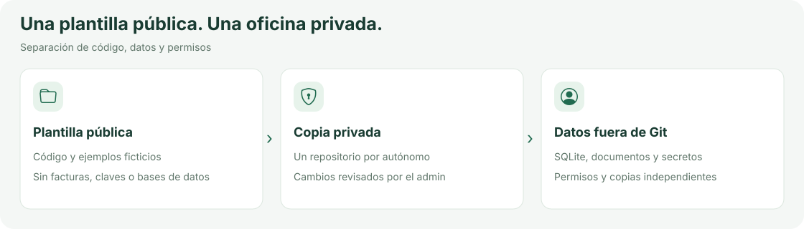
</picture>

Crea un repositorio nuevo **privado** desde esta plantilla. Conserva fuera de Git bases de datos, facturas, documentos, secretos y backups, también en las copias privadas. El formulario declara la copia privada; no verifica su visibilidad. El titular deberá autorizar Gmail, Drive y Calendar con permisos mínimos.

## Costes y revisión fiscal

<picture>
  <source media="(prefers-color-scheme: dark)" srcset="docs/images/costes-dark.svg">
  <source media="(prefers-color-scheme: light)" srcset="docs/images/costes-light.svg">
  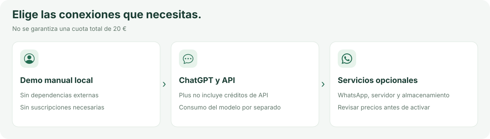
</picture>

La demo manual funciona localmente sin suscripciones. ChatGPT Plus **no incluye la API de OpenAI**; WhatsApp, API y alojamiento pueden tener costes. No se garantiza un total de 20 €. Las deducciones, facturas y obligaciones fiscales requieren implementación y revisión profesional; el prototipo no presenta impuestos ni certifica cumplimiento normativo.

## Guías y código

<picture>
  <source media="(prefers-color-scheme: dark)" srcset="docs/images/codigo-dark.svg">
  <source media="(prefers-color-scheme: light)" srcset="docs/images/codigo-light.svg">
  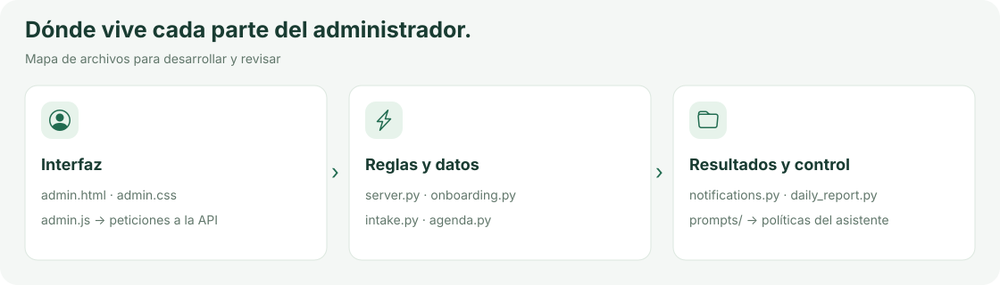
</picture>

- [Inicio en repositorio privado](docs/INICIO_PRIVADO.md) · [Código relevante del admin](docs/ADMIN_CODIGO.md)
- [Agenda, Calendar y contabilidad](docs/AGENDA.md) · [Plan de integraciones](docs/PLAN.md)
- [Prompts de acciones](prompts/sistema.md) · [Privacidad](docs/PRIVACIDAD.md)
- [Avisos y resúmenes diarios](docs/AVISOS.md): `python3 -m app.daily_report`

Pruebas:

```bash
python3 -m unittest discover -s tests -v
```

Ilustraciones SVG con versiones claras/oscuras y pictogramas de Bootstrap Icons (MIT). [Licencia de los iconos](app/static/icons/LICENSE). Sin fuentes externas, fotos ni rastreo.
