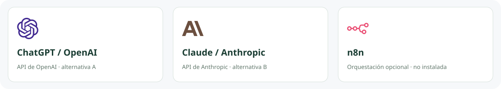
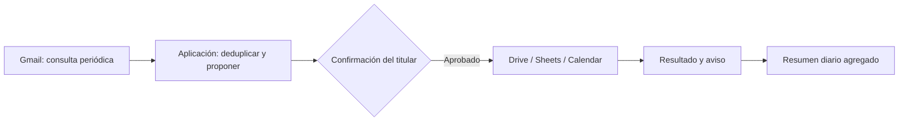

# IA intercambiable y n8n opcional

## Elegir una IA

| Opción | Entrada conversacional | Procesamiento en la aplicación |
| --- | --- | --- |
| OpenAI | ChatGPT con una herramienta autenticada compatible | API de OpenAI con cuenta y clave propias |
| Anthropic | Claude con una herramienta/conector compatible | API de Anthropic con cuenta y clave propias |

No hace falta contratar ambas. El admin puede guardar el proveedor para el futuro adaptador. La clave genérica `LLM_API_KEY` se guardará solo en el entorno privado. El proveedor seleccionado determina el SDK, modelo y destino de esa clave: no enviarla al otro proveedor. Los adaptadores de extracción y conversación todavía no están implementados. Elegir Claude como motor no significa que un mensaje en la aplicación Claude llegue automáticamente a esta oficina.

Antes de habilitar consumo: validar salida con el mismo esquema, exigir evidencia, medir exactitud en un conjunto reservado de documentos y aplicar el presupuesto local con reservas atómicas y tarifas verificadas. Las APIs y suscripciones de chat son productos distintos. Ver precios y condiciones vigentes: https://openai.com/api/pricing/ y https://www.anthropic.com/pricing.

## ¿Conviene n8n?

Puede ser útil para que el administrador visualice y mantenga los pasos: consultar Gmail, llamar a la aplicación, esperar aprobación, escribir en Drive/Calendar y gestionar avisos. La base de datos de la aplicación conserva IDs, validaciones, confirmaciones y deduplicación; no deben dispersarse esas reglas entre workflows.

| Con n8n | Sin n8n |
| --- | --- |
| Flujos visuales y conectores existentes | Menos procesos y componentes |
| Hay que proteger n8n, actualizarlo y respaldar sus datos | Hay que implementar los conectores en Python |
| Requiere credenciales y clave de cifrado estables | Requiere gestión segura de tokens en la aplicación |

**Recomendación:** no hacerlo obligatorio en la primera implantación. Si se adopta, instalarlo localmente en la misma máquina, con almacenamiento persistente y sin exposición pública por defecto. Apagado el ordenador, n8n tampoco recibe ni ejecuta nada. Su Cloud puede tener coste; self-hosted consume recursos y está sujeto a su licencia, que debe revisarse para ofrecer servicios a clientes. No asumir que toda modalidad comercial está permitida por ser descargable.

## Flujo conceptual, todavía no instalado

Un fallo de envío reintenta el aviso, no la operación contable. Los IDs deben ser estables y el resultado externo debe confirmarse antes de marcar éxito. n8n no puede llamar al servidor actual sin añadir autenticación y un contrato de API para integración.

Fuentes: https://docs.n8n.io/hosting/ · https://docs.n8n.io/sustainable-use-license/.
