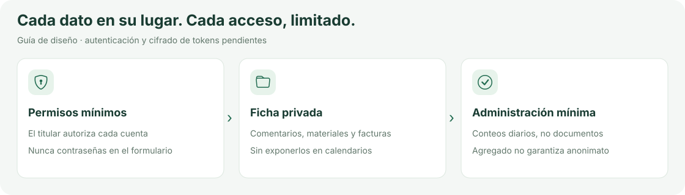

# Privacidad y operación

<picture>
  <source media="(prefers-color-scheme: dark)" srcset="images/privacidad-dark.svg">
  <source media="(prefers-color-scheme: light)" srcset="images/privacidad-light.svg">
  
</picture>

Esta versión es un prototipo local sin autenticación: utilizar datos ficticios. SQLite no está cifrado por la aplicación. El acceso al equipo permite leer sus archivos. No habilitar acceso externo al servidor de desarrollo.

Antes de producción: identificar al responsable del tratamiento, finalidades y bases jurídicas; facilitar información de privacidad, plazos de conservación y ejercicio de derechos; revisar contratos con encargados y transferencias internacionales conforme a RGPD/LOPDGDD. Limitar accesos del administrador y de la asesoría. Pedir consentimiento o disponer de otra base válida cuando proceda; la autorización OAuth no resuelve por sí sola todas las obligaciones.

No solicitar contraseñas de Gmail, ChatGPT o WhatsApp. Usar OAuth y mecanismos oficiales, permisos mínimos y revocables, y gestor de secretos. No incluir tokens en registros, URLs, documentación o copias Git. No enviar documentos a IA sin informar del proveedor y del tratamiento. No registrar cuerpos de correos ni archivos completos en logs de diagnóstico.

Mantener las bases de datos y originales fuera del control de versiones. Con el servidor detenido, realizar copias cifradas de SQLite y documentos a almacenamiento privado, comprobar restauración y aplicar retención. Si el servidor sigue funcionando, usar la API de backup de SQLite para obtener una copia consistente. Un repositorio privado no sustituye una política de seguridad o una copia de respaldo.

Para despliegue futuro: HTTPS, autenticación y autorización por objeto, protección CSRF y de sesiones, límites de subida, validación de formatos y malware, firmas de webhooks, protección contra instrucciones maliciosas en documentos, auditoría sin secretos y pruebas de restauración y aislamiento. Las credenciales y los adjuntos deberán quedar fuera del directorio servido por HTTP.
